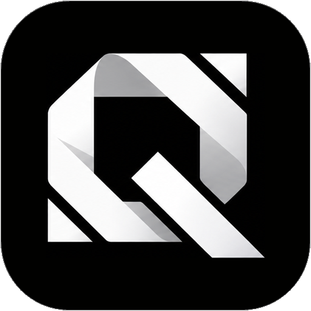
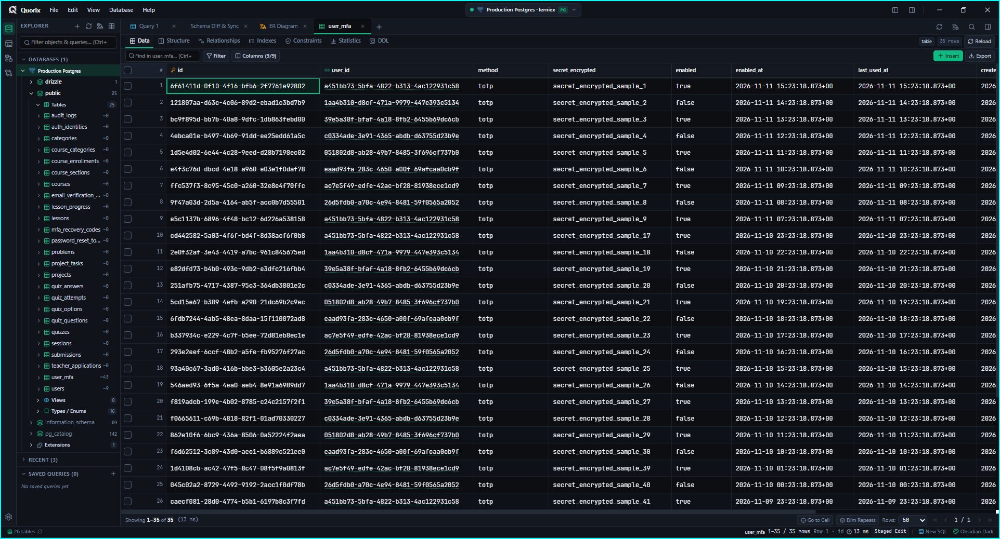
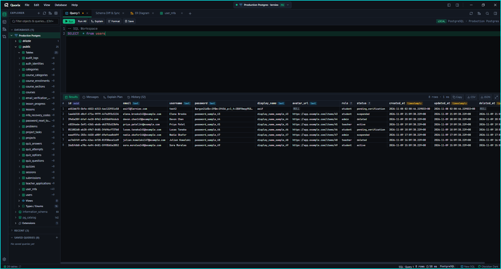
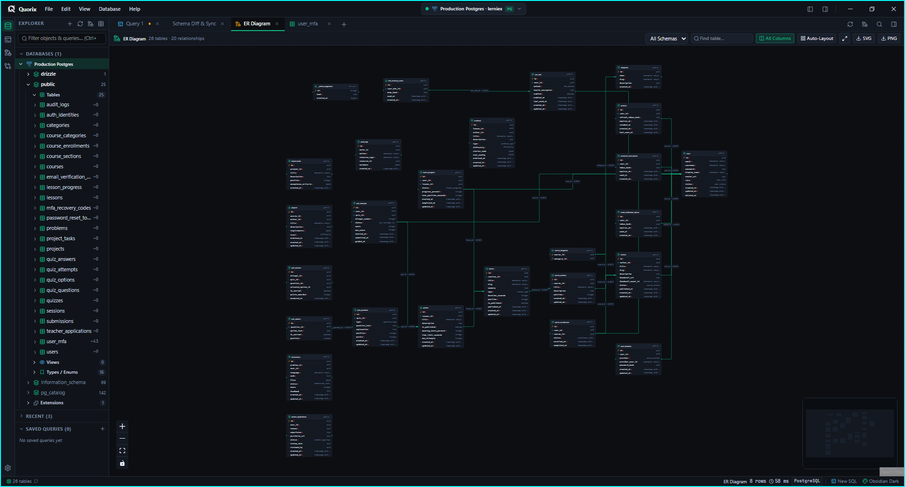

<div align="center">
  <br />
  <picture>
    <source media="(prefers-color-scheme: dark)" srcset="src/assets/logos/quorix-badge-dark.png" />
    <source media="(prefers-color-scheme: light)" srcset="src/assets/logos/quorix-badge-light.png" />
    
  </picture>

  <h1>Quorix</h1>
  <p><strong>A fast, keyboard-first desktop database workspace.</strong></p>
  <p>Instant studio for <strong>PostgreSQL</strong>, <strong>MySQL</strong>, and <strong>SQLite</strong> with zero bloat.</p>

  <p>
    <a href="https://github.com/Asif-4520/Quorix/releases">
      
    </a>
  </p>

  <p>
    <code>⚡ Instant Launch</code> &nbsp;•&nbsp;
    <code>🍃 Low Memory</code> &nbsp;•&nbsp;
    <code>⌨️ Keyboard-Driven</code> &nbsp;•&nbsp;
    <code>🔒 OS Keychain Secrets</code> &nbsp;•&nbsp;
    <code>✨ 100% Free &amp; Open Source</code>
  </p>

  <br />

  

  <br />
</div>

---

### Why Developers Choose Quorix

<table>
  <tr>
    <td width="50%" valign="top">
      <h4>🪟 No Squeezed Columns</h4>
      <p>Opening record details never crushes your table into tiny, unreadable columns. Quorix uses an <strong>overlay drawer</strong> over the side so your grid stays wide and fixed underneath.</p>
    </td>
    <td width="50%" valign="top">
      <h4>🔗 Teleport Across Foreign Keys</h4>
      <p>Landed on an ID? Press <kbd>Ctrl</kbd>+<kbd>J</kbd> or click the link icon to jump directly to the referenced row in the parent table. <strong>Zero manual <code>SELECT</code> or <code>JOIN</code> queries needed.</strong></p>
    </td>
  </tr>
  <tr>
    <td width="50%" valign="top">
      <h4>⌨️ Command Palette for Everything</h4>
      <p>Hit <kbd>Ctrl</kbd>+<kbd>Shift</kbd>+<kbd>P</kbd> to search across your whole database: <code>#</code> for tables, <code>@</code> for columns, <code>&gt;</code> for commands, and <code>$</code> for saved queries.</p>
    </td>
    <td width="50%" valign="top">
      <h4>🛡️ Safe Production Guardrails</h4>
      <p>Clear <code>LOCAL</code>, <code>STAGING</code>, and <code>PROD</code> badges keep you alert. Edit batches calmly in <strong>Staged Mode</strong> with <kbd>Ctrl</kbd>+<kbd>Alt</kbd>+<kbd>Z</kbd> instant discard before saving.</p>
    </td>
  </tr>
</table>

---

### See It In Action

<table>
  <tr>
    <td width="50%" valign="top">
      <a href="src/assets/screenshots/quorix-sql-console.png">
        
      </a>
      <h4>⚡ Instant SQL Runner</h4>
      <p>Monaco editor with syntax highlighting, parameter substitution, sub-millisecond execution times, and 1-click CSV/JSON exports.</p>
    </td>
    <td width="50%" valign="top">
      <a href="src/assets/screenshots/quorix-er-diagram.png">
        
      </a>
      <h4>🗺️ Interactive ER Diagram</h4>
      <p>Visual schema topology with auto-layout, interactive foreign key relationship arrows, minimap navigation, and crisp SVG / PNG export.</p>
    </td>
  </tr>
</table>

---

### Everyday Shortcuts

| What you want to do | Keys |
| :--- | :--- |
| Find any table, column, or query | <kbd>Ctrl</kbd>+<kbd>Shift</kbd>+<kbd>P</kbd> |
| Edit cell in Floating Inspector | <kbd>Double-click</kbd> or <kbd>Space</kbd> |
| Jump to referenced Foreign Key row | <kbd>Ctrl</kbd>+<kbd>J</kbd> |
| Discard pending changes before saving | <kbd>Ctrl</kbd>+<kbd>Alt</kbd>+<kbd>Z</kbd> |
| Explain query plan / Format SQL | <kbd>Ctrl</kbd>+<kbd>E</kbd> / <kbd>Shift</kbd>+<kbd>Alt</kbd>+<kbd>F</kbd> |
| Open Settings or Keymap in a new window | <kbd>Ctrl</kbd>+<kbd>,</kbd> / <kbd>Ctrl</kbd>+<kbd>Alt</kbd>+<kbd>,</kbd> |

---

### Supported Databases

- 🐘 **PostgreSQL** — URL or host/port, SSL modes, PgBouncer pooling, full catalog exploration.
- 🐬 **MySQL / MariaDB** — Host/port, URL parser, SSL options, fast schema browsing.
- 🪶 **SQLite** — Native file picker, create new databases on the spot, and maintenance checks.

---

### Quick Start

1. Download the app for **Windows**, **macOS**, or **Linux** from **[GitHub Releases](https://github.com/Asif-4520/Quorix/releases)**.
2. Paste your database link or select a local `.sqlite` file.
3. Start browsing and editing — no account, no setup, no telemetry.

<details>
<summary><strong>Build from Source</strong></summary>

<br />

```bash
git clone https://github.com/Asif-4520/Quorix.git
cd Quorix
pnpm install
pnpm tauri dev
```

</details>

---

### Story

I built Quorix because existing database viewers felt slow, heavy on memory, and cluttered with menus.

I first tried building it with Electron, but it quickly became sluggish and heavy. Instead of settling for a slow app, I used my frontend knowledge to design a calm, keyboard-driven UI, and used AI-assisted coding to build a native desktop backend.

The result is Quorix — a database client that starts instantly, protects your live data, and lets you work without fighting your screen.

---

<div align="center">
  Crafted by <strong>Asif Hossain</strong> (<a href="https://github.com/Asif-4520">@Asif-4520</a>) · Licensed under <a href="LICENSE">MIT</a>
</div>
